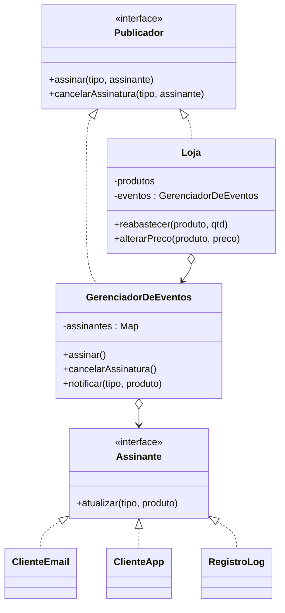

# AlertaLoja — Padrão de Projeto Observer

## 1. Explicação do projeto

O **AlertaLoja** simula uma loja que avisa automaticamente quem tem interesse nos seus produtos.
É o mesmo cenário usado para explicar o Observer: um cliente quer saber quando um produto chega
(ou quando o preço cai) e **não precisa ficar visitando a loja** para conferir.

- **Loja** (publicadora): cadastra produtos, reabastece o estoque e altera preços.
- **Eventos**: `PRODUTO_DISPONIVEL` (estoque saiu de 0 para mais que 0) e `PRECO_REDUZIDO` (novo preço menor que o anterior).
- **Assinantes**: quem quiser pode se inscrever em um ou mais eventos e deixar a inscrição quando quiser.
  - `ClienteEmail` – avisa por e-mail (simulado no console)
  - `ClienteApp` – envia notificação push (simulada)
  - `RegistroLog` – guarda o histórico do que aconteceu na loja

A inscrição é dinâmica: o programa mostra um cliente cancelando a assinatura e deixando de ser avisado.

### Como executar

Requisito: JDK 8 ou superior e uma IDE (Eclipse, IntelliJ, etc.).

1. Importe a pasta do projeto na IDE.
2. Abra a classe `apresentacao/MiniLojaApp.java`.
3. Execute a classe (Run). Ela contém o `main` e roda a demonstração completa no console.

## 2. Estrutura do projeto

```
AlertaLoja
└── src
    ├── apresentacao
    │   └── MiniLojaApp.java          (cliente: monta tudo e executa a demonstração)
    ├── loja
    │   ├── Publicador.java           (interface do publicador: assinar / cancelar)
    │   ├── Loja.java                 (publicador concreto: regra de negócio)
    │   ├── GerenciadorDeEventos.java (lista de assinantes + notificação)
    │   └── Produto.java              (dados do produto)
    ├── assinantes
    │   ├── Assinante.java            (interface do assinante: atualizar)
    │   ├── ClienteEmail.java
    │   ├── ClienteApp.java
    │   └── RegistroLog.java
    └── eventos
        └── TipoEvento.java
```

### Diagrama de classes



### Correspondência com a estrutura do Observer

| Papel no padrão       | Classe do projeto                          |
|-----------------------|--------------------------------------------|
| Publicadora           | `Loja`                                     |
| Infra de inscrição    | `GerenciadorDeEventos` (usado por composição) |
| Interface do assinante| `Assinante` (método `atualizar`)           |
| Assinantes concretos  | `ClienteEmail`, `ClienteApp`, `RegistroLog`|
| Cliente               | `MiniLojaApp` (cria e registra os objetos) |

## 3. Justificativa do padrão escolhido

### Por que o Observer é o mais adequado?

O problema é: **vários objetos precisam reagir a mudanças em outro objeto, e não sabemos de antemão quantos são nem quais são.**
Isso é exatamente a aplicabilidade do Observer.

Sem o padrão, só existem duas saídas ruins:

1. O cliente consulta a loja o tempo todo (*polling*): desperdício, a maioria das consultas é em vão.
2. A loja envia mensagem para todos os clientes a cada novidade: spam e acoplamento da loja com cada forma de contato.

Com o Observer:

- A loja **só avisa quem se inscreveu**, no evento que interessa.
- A inscrição é **dinâmica**: assinantes entram e saem em tempo de execução.
- A loja **não conhece as classes concretas** dos assinantes; só conhece a interface `Assinante`.
- Novos tipos de aviso (SMS, WhatsApp, painel) entram **sem alterar a `Loja`**.

### Outros padrões que poderiam ser usados

| Padrão / alternativa | Serviria? | Comentário |
|----------------------|-----------|------------|
| **Mediator**         | Sim, em parte | Um mediador central intermediaria loja e clientes. Elimina dependências diretas, mas cria um objeto central que sabe de todos, e aqui a comunicação é de **uma via** (loja → clientes), o foco do Observer. Uma implementação popular do Mediator usa o próprio Observer. |
| **Publish/Subscribe com broker (Event Bus)** | Sim | É a versão distribuída do Observer, com um intermediário entre publicador e assinante. Seria exagero para um sistema pequeno e de um só processo. |
| **Chain of Responsibility** | Não é o ideal | Passa o pedido por uma corrente até alguém tratar. Aqui **todos** os interessados devem ser avisados. |
| **Command**          | Não é o ideal | Cria conexão unidirecional fixa entre remetente e destinatário; não oferece inscrição dinâmica. |
| **Strategy**         | Complementar | Poderia escolher *como* notificar (e-mail, push), mas não resolve *quem* deve ser notificado e *quando*. |

## 4. Como os princípios SOLID foram aplicados

| Princípio | Onde aparece no projeto |
|-----------|-------------------------|
| **S**RP – Responsabilidade Única | `Produto` só guarda dados; `Loja` só tem a regra de negócio; `GerenciadorDeEventos` só cuida de inscrições e notificações; cada assinante só sabe reagir de um jeito. |
| **O**CP – Aberto/Fechado | Para criar um novo tipo de aviso, basta uma nova classe que implemente `Assinante` (ex.: `ClienteApp` foi adicionado sem tocar em `Loja`). A `Loja` está fechada para modificação e aberta para extensão. |
| **L**SP – Substituição de Liskov | Qualquer `Assinante` pode ser usado no lugar de outro sem quebrar a loja. Não há herança forçada: usamos **interfaces** e **composição** (a `Loja` *tem um* `GerenciadorDeEventos`, não *é um*). |
| **I**SP – Segregação de Interfaces | Interfaces pequenas: `Publicador` (só inscrição) e `Assinante` (só `atualizar`). Nenhuma classe implementa método que não usa. |
| **D**IP – Inversão de Dependências | A `Loja` e o `GerenciadorDeEventos` dependem da abstração `Assinante`, nunca de `ClienteEmail`, `ClienteApp` etc. Quem escolhe as classes concretas é o `MiniLojaApp`. |

### Prós e contras do Observer (neste projeto)

- ✅ Respeita o OCP: novos assinantes sem mexer na publicadora.
- ✅ Relações entre objetos criadas em tempo de execução.
- ⚠️ A ordem de notificação dos assinantes não deve ser considerada garantida (neste código, segue a ordem de inscrição, mas isso é detalhe de implementação).
- ⚠️ Assinantes que não cancelam a inscrição continuam recebendo avisos (e mantêm o objeto na memória).

## 5. Decisões de implementação

- `enum TipoEvento` evita erros de digitação com strings e limita os eventos possíveis.
- A lista de assinantes é copiada antes de notificar, para que um assinante possa cancelar durante o aviso sem causar erro.
- Código compatível com **Java 8**.
- Sem bibliotecas externas.
